<p align="center"></p>
<div align="center">

    

Memora is a durable, retrievable memory API that turns files into versioned extractions, chunks, pgvector embeddings and a FalkorDB knowledge graph.

</div>

> [!TIP]
> **Ingest once, ask anywhere** — every answer reuses the same versioned chunks, vectors, and graph facts.

## Contents
1. [❓ The problem](#-the-problem)
2. [✅ Our solution](#-our-solution)
3. [🧩 Features](#-features)
4. [🧠 How it works](#-how-it-works)
5. [🏗️ Architecture](#-architecture)
6. [🗃️ Data model](#-data-model)
7. [🛠️ Tech stack](#-tech-stack)
8. [⚡ Quick start](#-quick-start)
9. [⚙️ Configuration](#-configuration)
10. [🔌 API](#-api)
11. [🧪 Testing](#-testing)
12. [📁 Repository](#-repository)
13. [📄 License](#-license)
---
## ❓ The problem
Apps that need durable, retrievable context — cases, projects, agents — lose it. Files live outside the app, extractions are re-run and forgotten, and answers drift from sources. That is the whole reason `backend/app/db/models/` exists: to persist memory, not just store bytes.

| If you just … | What happens | Why it hurts |
|---|---|---|
| Store raw files or URLs in `backend/app/db/models/source.py` | No versioned reading, no reusable chunks | Every prompt re-reads from scratch |
| Re-extract on every request | No `source_extractions` versions, no cost ledger | You pay twice and cannot reproduce answers |
| Bolt on vectors without ownership | Embeddings without `Tenant->Application->Actor->Subject->Source` scope | One app can read another tenant's data |
| Ask an LLM directly | No grounding in chunks + graph evidence | Replies sound right but are not tied to sources |

---
## ✅ Our solution
Memora is a memory API with ownership + pipeline: own knowledge, process it once, ask it with grounding.
1. **Own it** — create `Tenant -> Application -> Actor -> Subject` in `backend/app/db/models/`, then register `Source` rows under the right subject. `tenant_id`/`application_id` are copied from the parent, never accepted from the client.
2. **Ingest it** — `POST /subjects/{id}/sources/upload` with `extract=true`, or record a `url` source with no bytes. Every run creates a new version in `source_extractions` with models, tokens, and cost.
3. **Reuse it** — the same version feeds chunking (`backend/app/chunking/`), pgvector embeddings (`backend/app/services/embedding_service.py`), and the per-tenant FalkorDB graph (`backend/app/graph/store.py`).
4. **Ask it** — `POST /api/v1/query` in `backend/app/api/routes/retrieval.py` runs HNSW top50 → MMR top10 → rerank top5 → LLM, or browse everything in the Next.js console in `console/src/app/`.
5. The benefit that matters most: **ingest once, then every query reuses the same versioned chunks, vectors, and graph facts.**
---
## 🧩 Features
**App developers**
- **Versioned extractions:** every `POST /sources/{id}/extractions` in `backend/app/api/routes/extractions.py` creates v1, v2, … with readings, content, models, and usage.
- **Three-level chunking:** `backend/app/chunking/` parses readings to `DocumentUnit` → `SemanticBlock` → `RetrievalChunk` with `embedding_text`.
- **Vector embeddings:** `backend/app/services/embedding_service.py` enqueues by `input_hash`, embeds via NVIDIA NIM, and stores `Vector(2048)` behind HNSW.
- **Retrieval ask:** `POST /query` in `backend/app/services/retrieval_service.py` returns a grounded answer or chunks-only with `generate=false`.
- **Bearer auth:** `Authorization: Bearer memora_...` in `backend/app/api/deps.py` is HMAC-hashed, scoped to its application and tenant.
- **Usage ledger:** `backend/app/api/routes/usage.py` groups cost by application, model, and trigger.

**Operators**
- **Ops console:** `console/src/components/Shell.tsx` gives a Tenants → Applications → Actors → Subjects → Sources rail with list + detail routes.
- **Extract / graph / embedding panels:** trigger extractions, `POST /sources/{id}/graph`, and drain/retry embeddings without curl.
- **Dashboard + graph viz:** `backend/app/api/routes/dashboard.py` powers stats/metrics/`whoami`, with `SubjectTree` and graph views in `console/src/components/`.
- **Google sign-in:** `backend/app/api/routes/auth.py` uses HttpOnly session cookies; no bearer tokens in the browser.

**Everyone**
- **Knowledge graph:** `backend/app/graph/` extracts entities/relationships per chunk, resolves with deterministic UUIDv5, and stores one graph per tenant in FalkorDB.
- **Public docs site:** `web/src/app/docs/` renders pipeline, ownership chain, and `Endpoint`/`Fields` API reference with links into the console.
---
## 🧠 How it works
<p align="center"></p>

- **Source → Processor → Extraction → version:** `backend/app/services/extraction_service.py` runs `DocumentProcessor` + `ExtractionAgent`, never leaves a run stuck in `processing`, and persists a new `source_extractions` version.
- **Chunk once, rechunk free:** `backend/app/services/chunking_service.py` converts stored `readings` to units, blocks, and active `retrieval_chunks`; old versions are deactivated, not deleted.
- **Idempotent embeddings:** `backend/app/services/embedding_service.py` uses `(chunk, strategy, input_hash)` uniqueness plus `SELECT ... FOR UPDATE SKIP LOCKED` and a daemon drain to NIM, normalizing to `halfvec(2048)`.
- **Per-tenant graph with provenance:** `backend/app/graph/ingestion.py` parallel-extracts per chunk, `backend/app/graph/resolution.py` dedups, and `backend/app/graph/store.py` MERGEs `Document/Chunk/Entity` nodes with source + chunk provenance.
- **Grounded retrieval:** `backend/app/services/retrieval_service.py` does scoped HNSW top50 → MMR top10 (`lambda 0.7`) → rerank top5 → LLM answered ONLY from context chunks + graph evidence.
---
## 🏗️ Architecture
<p align="center"></p>

| Part | Job |
|---|---|
| Backend API (`backend/app/main.py`, `backend/app/api/routes/`) | 19 routers under `/api/v1`, thin handlers + `Scope` enforcement, `/health` probe and lifespan recovery |
| Auth + ownership (`backend/app/api/deps.py`, `backend/app/services/scope.py`, `backend/app/services/credential_service.py`) | `memora_` HMAC lookup vs console session; cross-tenant reads return 404, not 403 |
| Ingest + extraction (`backend/app/services/extraction_service.py`, `backend/app/agents/`, `backend/app/processing/`) | Upload/text ingest, triage, `nvidia/` layout/vision/extract models, version + cost ledger |
| Chunking (`backend/app/chunking/`, `backend/app/services/chunking_service.py`) | `parse_readings` → `build_semantic_blocks` → `chunk_semantic_block` with `embedding_text` |
| Embeddings (`backend/app/services/embedding_service.py`, `backend/app/embeddings/provider.py`) | Strategy catalog, idempotent queue, NIM provider, `halfvec(2048)` HNSW `M16, ef64` in Postgres |
| Knowledge graph (`backend/app/graph/`, `backend/app/services/graph_service.py`) | Per-chunk LLM extract, UUIDv5 resolution, per-tenant FalkorDB writes, deterministic BFS retrieval |
| Retrieval (`backend/app/services/retrieval_service.py`, `backend/app/retrieval/mmr.py`, `backend/app/retrieval/reranker.py`) | HNSW → MMR → rerank → grounded LLM, fallback to MMR order on rerank error |
| Console (`console/src/app/`, `console/src/components/Shell.tsx`) | Next.js ops console on `:3000`, ownership rail, extraction/graph/embedding panels |
| Web docs (`web/src/app/page.tsx`, `web/src/app/docs/`, `web/src/components/docs.tsx`) | Public landing + six-stage pipeline and reference on `:3001`, no login |
| Storage (local disk / R2) | `STORAGE_DIR` locally, `R2_*` in production for source bytes |
---
## 🗃️ Data model
Everything hangs off one chain in `backend/app/db/models/`. Read it top to bottom:

| Entity | What it holds |
|---|---|
| `Tenant -> Application -> Actor -> Subject -> Source` | Tenant owns applications; application maps `external_id` actors (no email/role); subject is the workspace/folder with `parent_subject_id` and `actor_id = created-by`; source denormalizes `tenant_id`/`application_id` from its subject in `backend/app/db/models/source.py` |
| `SourceExtraction` | Versioned runs `v1, v2, …` with `status/mode/instructions`, `provider/models/result/content/readings`, `tokens/cost`, triggered-by attribution in `backend/app/db/models/extraction.py` |
| `DocumentUnit / SemanticBlock / RetrievalChunk` | Parsed units grouped per section, then retrieval-sized chunks with `chunk_index`, `embedding_text`, `token_count`, `is_active` and ordered cascade delete in `backend/app/db/models/chunking.py` |
| `EmbeddingModel / EmbeddingStrategy / ChunkEmbedding` | Model catalog + immutable strategy (`Memora Dense v1` / `nvidia/nemotron-3-embed-1b` default); `ChunkEmbedding` is `Vector(2048)` with `pending → processing → completed/failed/stale` and `(chunk, strategy, input_hash)` uniqueness in `backend/app/db/models/embedding.py` |
| `SourceGraphBuild` | Postgres record of graph builds: source/extraction version, chunking params, counts, `failed_chunks`, stats, tokens/cost; the graph itself lives in FalkorDB per tenant in `backend/app/db/models/graph.py` |
| `ExtractionUsage` | Cost ledger behind `GET /extractions` in `backend/app/api/routes/usage.py`, grouped by application/model/trigger |
---
## 🛠️ Tech stack
| Layer | Technology | Why |
|---|---|---|
| Language | Python 3.12 + TypeScript | Backend FastAPI/SQLAlchemy; console/web Next.js 16 + React 19 + Tailwind 4 in `console/package.json` |
| Framework | FastAPI + Next.js App Router | 19 routers under `/api/v1` in `backend/app/main.py`; console ops + public docs site |
| Database | Postgres + pgvector + Alembic | System of record; `halfvec(2048)` HNSW in `backend/migrations/versions/d4e5f6a7b8c9_embedding_tables.py`; migrations from `Base.metadata` in `backend/migrations/env.py` |
| Graph + storage | FalkorDB + local disk / Cloudflare R2 | One graph per tenant via `graph_name` in `backend/app/graph/store.py`; `STORAGE_DIR` vs `R2_*` bytes |
| Library | `openai` SDK + `rapidfuzz`, `sqlalchemy`, `psycopg` | NVIDIA NIM embeddings/LLM/rerank client in `backend/app/embeddings/provider.py`; deterministic resolution; `postgresql+psycopg://` driver in `backend/requirements.txt` |
| Service | NVIDIA NIM + Google Identity | `nvidia/` extract/vision/parse/embed/rerank models; console Google-only sign-in in `backend/app/services/auth_services.py` |
---
## ⚡ Quick start
You need Python 3.12+, Node 20.9+, and Postgres (Neon or local). API on `:8000`, console on `:3000`, docs on `:3001`.

```bash
# 1. Database — local container, or Neon with postgresql+psycopg:// prefix
docker run -d --name memora-pg \
  -e POSTGRES_USER=memora -e POSTGRES_PASSWORD=memora -e POSTGRES_DB=memora \
  -p 5432:5432 postgres:16-alpine
```

```bash
# 2. Backend :8000
cd backend
cp .env.example .env          # then set DATABASE_URL and API_SECRET
python3 -m venv .venv && .venv/bin/pip install -r requirements.txt
.venv/bin/alembic upgrade head
.venv/bin/uvicorn app.main:app --reload
```

```bash
# 3. Console :3000
cd console
cp .env.example .env.local    # NEXT_PUBLIC_API_BASE_URL defaults to :8000
npm install
npm run dev
```

```bash
# 4. Docs site :3001
cd web
npm install
npm run dev
```

Register a file — both land in `pending` with ownership copied from the subject:

```bash
# Post the bytes. Memora stores them and returns a tracked source row.
curl -X POST http://localhost:8000/api/v1/subjects/$SUBJECT_ID/sources/upload \
  -H "Authorization: Bearer memora_..." \
  -F "file=@complaint.pdf;type=application/pdf" \
  -F "created_by_actor_id=$ACTOR_ID"

# Or record a source whose content lives elsewhere, moving no bytes.
curl -X POST http://localhost:8000/api/v1/subjects/$SUBJECT_ID/sources \
  -H "Authorization: Bearer memora_..." -H "Content-Type: application/json" \
  -d '{"type":"url","filename":"Statute reference",
       "storage_uri":"https://law.example.gov/statutes/1204"}'
```

Interactive schema is at `http://localhost:8000/docs`.
---
## ⚙️ Configuration
Copy `backend/.env.example` to `backend/.env` and `console/.env.example` to `console/.env.local`.

| Variable | Value / purpose |
|---|---|
| `DATABASE_URL` | Must use `postgresql+psycopg://` prefix for SQLAlchemy psycopg 3 in `backend/.env.example` |
| `API_SECRET` | Keys HMAC token hashing in `backend/app/services/credential_service.py`; rotating it invalidates every credential |
| `ENVIRONMENT` | `local` uses build.nvidia.com + disk; `production` uses Nebius + R2 |
| `NVIDIA_API_KEY` / `NEBIUS_API_KEY` | Development vs demo/production model providers |
| `STORAGE_DIR` / `R2_*` | Local-disk dir vs Cloudflare R2 production storage |
| `FALKORDB_URL` | Empty disables graph with 503s; `falkor://` plain local, `falkors://` TLS Cloud in `backend/app/api/deps.py` |
| `LLM_EXTRACT_MODEL`, `LLM_VISION_MODEL`, `LLM_LAYOUT_MODEL` | Must start with `nvidia/` |
| `GOOGLE_CLIENT_ID` | Must match console `NEXT_PUBLIC_GOOGLE_CLIENT_ID`; every Google token is checked against it |
| `NEXT_PUBLIC_API_BASE_URL` | Browser → backend URL in `console/.env.example`; must never hold a secret |
| `API_PROXY_TARGET` | Forwards `/api/v1/*` in `console/next.config.ts` so the session cookie stays first-party |
| `retrieval_hnsw_top_k`, `retrieval_mmr_top_k`, `retrieval_final_top_k` | Defaults `50 / 10 / 5` in `backend/app/core/config.py` |
| `retrieval_mmr_lambda` | Defaults `0.7` relevance/diversity trade-off |
| `TEST_DATABASE_URL` | Throwaway real Postgres for `backend/tests/` |

Keep `.env` and `.env.local` out of git — copy from `.env.example` and never commit secrets.
---
## 🔌 API
All endpoints are under `/api/v1` in `backend/app/main.py`. Nested paths express ownership.

| Name | Purpose |
|---|---|
| `POST/GET /tenants`, `GET/PATCH /tenants/{id}` | Ownership root in `backend/app/api/routes/tenants.py` |
| `POST/GET /tenants/{id}/applications`, `GET/PATCH /applications/{id}` | Consuming application in `backend/app/api/routes/applications.py` |
| `POST/GET /applications/{id}/credentials`, `PATCH/DELETE /credentials/{id}` | Issue one-time `memora_` token, list, revoke in `backend/app/api/routes/credentials.py` |
| `POST/GET /applications/{id}/actors`, `GET/PATCH /actors/{id}` | Your `external_id` identity map in `backend/app/api/routes/actors.py` |
| `POST/GET /applications/{id}/subjects`, `GET/PATCH /subjects/{id}` | Workspace/folder boundary + move/delete in `backend/app/api/routes/subjects.py` |
| `POST/GET /subjects/{id}/sources`, `POST /subjects/{id}/sources/upload` | Register URL/text or upload bytes with `extract=true` in `backend/app/api/routes/sources.py` |
| `GET /sources`, `GET/PATCH/DELETE /sources/{id}`, `GET /sources/{id}/content`, `POST /sources/{id}/move` | Source CRUD, download, and re-parenting |
| `POST /sources/{id}/extractions`, `GET /sources/{id}/extractions/latest`, `GET /sources/{id}/extractions/{version}` | Start next version (202 `processing`, 409 if running), poll versions in `backend/app/api/routes/extractions.py` |
| `POST /sources/{id}/graph`, `GET /sources/{id}/graph/builds`, `GET/POST /subjects/{id}/graph` | Build from latest extraction, list builds, deterministic 1–3 hop query; 503 if unconfigured in `backend/app/api/routes/graph.py` |
| `GET /embedding/strategies`, `PATCH /embedding/strategies/{id}`, `POST /embedding/*`, `GET /embedding/stats`, `POST /embedding/query` | Immutable strategies (only description/`is_active` patchable), enqueue/drain/retry/stats, embed-without-search in `backend/app/api/routes/embeddings.py` |
| `POST /query` | Synchronous read-only HNSW → MMR → rerank → LLM in `backend/app/api/routes/retrieval.py`; `subject_id`/`source_id` narrow scope, `generate=false` returns chunks only |
| `GET /sources/{id}/chunks` | Inspect active `retrieval_chunks` in `backend/app/api/routes/chunks.py` |
| `GET /extractions`, `GET /stats`, `GET /stats/metrics`, `GET /whoami`, `GET /health` | Cost ledger, dashboard, credential resolution in `backend/app/api/routes/usage.py`, `dashboard.py`, and `backend/app/main.py` |
| `POST /auth/google`, `GET /auth/me`, `POST /auth/logout` | Console Google-only login with HttpOnly cookie in `backend/app/api/routes/auth.py` |

```bash
# Extract, then build the graph from that extraction
curl -X POST http://localhost:8000/api/v1/sources/$SOURCE_ID/extractions \
  -H "Authorization: Bearer memora_..."
curl -X POST http://localhost:8000/api/v1/sources/$SOURCE_ID/graph \
  -H "Authorization: Bearer memora_..."

# Ask — scope decides the corpus, filters narrow it
curl -X POST http://localhost:8000/api/v1/query \
  -H "Authorization: Bearer memora_..." -H "Content-Type: application/json" \
  --data-binary @- <<'JSON'
{"query": "What does the complaint allege?", "subject_id": "00000000-0000-0000-0000-000000000000"}
JSON
```

See `http://localhost:8000/docs` for exact `Endpoint`/`Fields` schemas also rendered in `web/src/components/docs.tsx`.
---
## 🧪 Testing
Runs on a real Postgres, not SQLite — the schema in `backend/migrations/` relies on native UUIDs, `gen_random_uuid()`, and `ON DELETE` behaviour SQLite cannot represent.

```bash
cd backend
TEST_DATABASE_URL=postgresql+psycopg://... .venv/bin/python -m pytest tests/ -q
```

- **Fixtures truncate every table** between tests in `backend/tests/` — point `TEST_DATABASE_URL` at a throwaway database.
- **Ownership is covered** in `backend/tests/test_ownership.py`: cross-tenant reads return 404 not 403, ownership columns are derived from the parent subject, and the whole chain must agree.
- **Pipeline is covered** across `backend/tests/` (21 files): version claim/409, `chunk_extraction` in `backend/app/services/chunking_service.py`, idempotent enqueue, and graph build/query paths.
---
## 📁 Repository
| Folder | What it is | Port |
|---|---|---|
| [backend/](backend/) | FastAPI + SQLAlchemy + Alembic API, `app/` services/routes, `migrations/` revisions, `tests/` suite | `:8000` |
| [console/](console/) | Next.js 16 ops console in `console/src/app/`, `console/src/components/`, `console/src/lib/` typed client | `:3000` |
| [web/](web/) | Public landing + API reference in `web/src/app/`, `web/src/components/docs.tsx`, no login | `:3001` |
| [docs/](docs/) | Decision records `extraction-agent.md`, `graph-rag.md` plus `readme/` banner/architecture/flow images | — |

```bash
cd backend && uvicorn app.main:app --reload   # :8000
cd console && npm run dev                     # :3000
cd web && npm run dev                         # :3001
```
---
## 📄 License
Licensed under the Apache License 2.0 — see [LICENSE](LICENSE) for details.

---

<sub>Generated by GitFill from `Gopinathv19/memora` at commit `b6357f6`.</sub>
